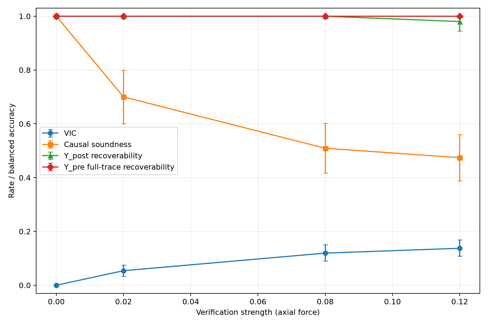

# Gate-0 Result

## 1. Terminal Decision
KILL

## 2. Exact Scientific Question
Did the connector insertion succeed before verification, or because the verification action caused it to succeed?

## 3. Experimental Setup
CPU-only MuJoCo connector insertion with 500 natural parent terminal states and five paired branches restored from identical `mjSTATE_INTEGRATION` snapshots.

## 4. Frozen Success Predicate
`depth >= 0.028`, `lateral <= 0.0015`, and `tilt <= 3.0°`. The normalized success margin is the minimum normalized component margin.

## 5. Natural Rollout Distribution
Pre-verification success rate: 0.112. Categories: `{"misaligned": 330, "near-success": 83, "successful": 56, "under-inserted": 31}`.

## 6. Verification Branches
V0 hold, V1 passive read-only, and V2/V3/V4 frozen axial probes. Check A=True; Check B=True; physical distinctness=True.

## 7. Verification-Induced Completion
| Branch | Strength | 0→0 | 0→1 | 1→0 | 1→1 | VIC | VIC 95% CI | VID | Causal soundness | Δcredit |
|---|---:|---:|---:|---:|---:|---:|---:|---:|---:|---:|
| V0 | 0.000 | 444 | 0 | 0 | 56 | 0.000 | [0.000, 0.000] | 0.000 | 1.000 | 0.000 |
| V1 | 0.000 | 444 | 0 | 0 | 56 | 0.000 | [0.000, 0.000] | 0.000 | 1.000 | 0.000 |
| V2 | 0.020 | 420 | 24 | 0 | 56 | 0.054 | [0.034, 0.074] | 0.000 | 0.700 | 0.048 |
| V3 | 0.080 | 391 | 53 | 1 | 55 | 0.119 | [0.090, 0.151] | 0.018 | 0.509 | 0.104 |
| V4 | 0.120 | 383 | 61 | 1 | 55 | 0.137 | [0.108, 0.169] | 0.018 | 0.474 | 0.120 |

VIC uses all `Y_pre=0` parents as its frozen denominator; the event additionally requires `control_Y_post=0` and probe `Y_post=1`.

| Branch | Near n | Near VIC | 95% CI |
|---|---:|---:|---:|
| V0 | 274 | 0.000 | [0.000, 0.000] |
| V1 | 274 | 0.000 | [0.000, 0.000] |
| V2 | 274 | 0.088 | [0.055, 0.120] |
| V3 | 274 | 0.193 | [0.146, 0.241] |
| V4 | 274 | 0.223 | [0.179, 0.274] |

## 8. Verification-Induced Disruption
Reported in the same complete transition metrics table and in `figures/transition_matrix.png`.

## 9. Causal Soundness
The table reports `P(Y_pre=1 | Y_post=1)` for every branch. V0 spontaneous completion rate was 0.000.

## 10. Y_post Recoverability
| Branch | Y_pre R3 suite max (model) | Y_post R3 suite max (model) |
|---|---:|---:|
| V0 | 1.000 (LogisticRegression) | 1.000 (LogisticRegression) |
| V1 | 1.000 (LogisticRegression) | 1.000 (LogisticRegression) |
| V2 | 1.000 (RandomForestClassifier) | 1.000 (LogisticRegression) |
| V3 | 1.000 (RandomForestClassifier) | 1.000 (LogisticRegression) |
| V4 | 1.000 (LogisticRegression) | 0.980 (RandomForestClassifier) |

## 11. Y_pre Retrospective Recoverability
R1 final state, R2 trajectory summaries, and R3 resampled full traces were each evaluated with LogisticRegression, RandomForestClassifier, and MLPClassifier using a disjoint parent-level split. The gate's predeclared strongest-baseline rule is `max_predeclared_suite` across the complete frozen suite. No post-hoc model family is added or removed.

## 12. Full-Trajectory Challenge
The table shows R3 balanced accuracy, not an impossibility bound. Both outcomes use the predeclared suite maximum. Train/test parent overlap: `[]`. Per-parent predictions and majority baselines are saved in the results ledgers.

| Branch | Target | Regime | Model | Train 0/1 | Test 0/1 | Status | Balanced accuracy | 95% CI | ROC-AUC |
|---|---|---|---|---:|---:|---|---:|---:|---:|
| V0 | Y_pre | R1_final | MajorityBaseline | 308/42 | 136/14 | OK | 0.500 | [0.500, 0.500] | N/A |
| V0 | Y_pre | R1_final | LogisticRegression | 308/42 | 136/14 | OK | 0.915 | [0.882, 0.945] | 0.952 |
| V0 | Y_pre | R1_final | RandomForestClassifier | 308/42 | 136/14 | OK | 1.000 | [1.000, 1.000] | 1.000 |
| V0 | Y_pre | R1_final | MLPClassifier | 308/42 | 136/14 | OK | 0.856 | [0.742, 0.956] | 0.966 |
| V0 | Y_pre | R2_summary | MajorityBaseline | 308/42 | 136/14 | OK | 0.500 | [0.500, 0.500] | N/A |
| V0 | Y_pre | R2_summary | LogisticRegression | 308/42 | 136/14 | OK | 0.923 | [0.890, 0.952] | 0.965 |
| V0 | Y_pre | R2_summary | RandomForestClassifier | 308/42 | 136/14 | OK | 0.996 | [0.989, 1.000] | 1.000 |
| V0 | Y_pre | R2_summary | MLPClassifier | 308/42 | 136/14 | OK | 0.907 | [0.803, 0.985] | 0.967 |
| V0 | Y_pre | R3_full_trace | MajorityBaseline | 308/42 | 136/14 | OK | 0.500 | [0.500, 0.500] | N/A |
| V0 | Y_pre | R3_full_trace | LogisticRegression | 308/42 | 136/14 | OK | 1.000 | [1.000, 1.000] | 1.000 |
| V0 | Y_pre | R3_full_trace | RandomForestClassifier | 308/42 | 136/14 | OK | 1.000 | [1.000, 1.000] | 1.000 |
| V0 | Y_pre | R3_full_trace | MLPClassifier | 308/42 | 136/14 | OK | 1.000 | [1.000, 1.000] | 1.000 |
| V0 | Y_post | R1_final | MajorityBaseline | 308/42 | 136/14 | OK | 0.500 | [0.500, 0.500] | N/A |
| V0 | Y_post | R1_final | LogisticRegression | 308/42 | 136/14 | OK | 0.915 | [0.882, 0.945] | 0.952 |
| V0 | Y_post | R1_final | RandomForestClassifier | 308/42 | 136/14 | OK | 1.000 | [1.000, 1.000] | 1.000 |
| V0 | Y_post | R1_final | MLPClassifier | 308/42 | 136/14 | OK | 0.856 | [0.742, 0.956] | 0.966 |
| V0 | Y_post | R2_summary | MajorityBaseline | 308/42 | 136/14 | OK | 0.500 | [0.500, 0.500] | N/A |
| V0 | Y_post | R2_summary | LogisticRegression | 308/42 | 136/14 | OK | 0.923 | [0.890, 0.952] | 0.965 |
| V0 | Y_post | R2_summary | RandomForestClassifier | 308/42 | 136/14 | OK | 0.996 | [0.989, 1.000] | 1.000 |
| V0 | Y_post | R2_summary | MLPClassifier | 308/42 | 136/14 | OK | 0.907 | [0.803, 0.985] | 0.967 |
| V0 | Y_post | R3_full_trace | MajorityBaseline | 308/42 | 136/14 | OK | 0.500 | [0.500, 0.500] | N/A |
| V0 | Y_post | R3_full_trace | LogisticRegression | 308/42 | 136/14 | OK | 1.000 | [1.000, 1.000] | 1.000 |
| V0 | Y_post | R3_full_trace | RandomForestClassifier | 308/42 | 136/14 | OK | 1.000 | [1.000, 1.000] | 1.000 |
| V0 | Y_post | R3_full_trace | MLPClassifier | 308/42 | 136/14 | OK | 1.000 | [1.000, 1.000] | 1.000 |
| V1 | Y_pre | R1_final | MajorityBaseline | 308/42 | 136/14 | OK | 0.500 | [0.500, 0.500] | N/A |
| V1 | Y_pre | R1_final | LogisticRegression | 308/42 | 136/14 | OK | 0.915 | [0.886, 0.945] | 0.952 |
| V1 | Y_pre | R1_final | RandomForestClassifier | 308/42 | 136/14 | OK | 1.000 | [1.000, 1.000] | 1.000 |
| V1 | Y_pre | R1_final | MLPClassifier | 308/42 | 136/14 | OK | 0.856 | [0.734, 0.956] | 0.966 |
| V1 | Y_pre | R2_summary | MajorityBaseline | 308/42 | 136/14 | OK | 0.500 | [0.500, 0.500] | N/A |
| V1 | Y_pre | R2_summary | LogisticRegression | 308/42 | 136/14 | OK | 0.923 | [0.890, 0.952] | 0.965 |
| V1 | Y_pre | R2_summary | RandomForestClassifier | 308/42 | 136/14 | OK | 0.996 | [0.989, 1.000] | 1.000 |
| V1 | Y_pre | R2_summary | MLPClassifier | 308/42 | 136/14 | OK | 0.907 | [0.803, 0.985] | 0.967 |
| V1 | Y_pre | R3_full_trace | MajorityBaseline | 308/42 | 136/14 | OK | 0.500 | [0.500, 0.500] | N/A |
| V1 | Y_pre | R3_full_trace | LogisticRegression | 308/42 | 136/14 | OK | 1.000 | [1.000, 1.000] | 1.000 |
| V1 | Y_pre | R3_full_trace | RandomForestClassifier | 308/42 | 136/14 | OK | 1.000 | [1.000, 1.000] | 1.000 |
| V1 | Y_pre | R3_full_trace | MLPClassifier | 308/42 | 136/14 | OK | 1.000 | [1.000, 1.000] | 1.000 |
| V1 | Y_post | R1_final | MajorityBaseline | 308/42 | 136/14 | OK | 0.500 | [0.500, 0.500] | N/A |
| V1 | Y_post | R1_final | LogisticRegression | 308/42 | 136/14 | OK | 0.915 | [0.886, 0.945] | 0.952 |
| V1 | Y_post | R1_final | RandomForestClassifier | 308/42 | 136/14 | OK | 1.000 | [1.000, 1.000] | 1.000 |
| V1 | Y_post | R1_final | MLPClassifier | 308/42 | 136/14 | OK | 0.856 | [0.734, 0.956] | 0.966 |
| V1 | Y_post | R2_summary | MajorityBaseline | 308/42 | 136/14 | OK | 0.500 | [0.500, 0.500] | N/A |
| V1 | Y_post | R2_summary | LogisticRegression | 308/42 | 136/14 | OK | 0.923 | [0.890, 0.952] | 0.965 |
| V1 | Y_post | R2_summary | RandomForestClassifier | 308/42 | 136/14 | OK | 0.996 | [0.989, 1.000] | 1.000 |
| V1 | Y_post | R2_summary | MLPClassifier | 308/42 | 136/14 | OK | 0.907 | [0.803, 0.985] | 0.967 |
| V1 | Y_post | R3_full_trace | MajorityBaseline | 308/42 | 136/14 | OK | 0.500 | [0.500, 0.500] | N/A |
| V1 | Y_post | R3_full_trace | LogisticRegression | 308/42 | 136/14 | OK | 1.000 | [1.000, 1.000] | 1.000 |
| V1 | Y_post | R3_full_trace | RandomForestClassifier | 308/42 | 136/14 | OK | 1.000 | [1.000, 1.000] | 1.000 |
| V1 | Y_post | R3_full_trace | MLPClassifier | 308/42 | 136/14 | OK | 1.000 | [1.000, 1.000] | 1.000 |
| V2 | Y_pre | R1_final | MajorityBaseline | 308/42 | 136/14 | OK | 0.500 | [0.500, 0.500] | N/A |
| V2 | Y_pre | R1_final | LogisticRegression | 308/42 | 136/14 | OK | 0.915 | [0.886, 0.945] | 0.950 |
| V2 | Y_pre | R1_final | RandomForestClassifier | 308/42 | 136/14 | OK | 0.989 | [0.974, 1.000] | 1.000 |
| V2 | Y_pre | R1_final | MLPClassifier | 308/42 | 136/14 | OK | 0.935 | [0.849, 0.985] | 0.974 |
| V2 | Y_pre | R2_summary | MajorityBaseline | 308/42 | 136/14 | OK | 0.500 | [0.500, 0.500] | N/A |
| V2 | Y_pre | R2_summary | LogisticRegression | 308/42 | 136/14 | OK | 0.919 | [0.886, 0.949] | 0.963 |
| V2 | Y_pre | R2_summary | RandomForestClassifier | 308/42 | 136/14 | OK | 1.000 | [1.000, 1.000] | 1.000 |
| V2 | Y_pre | R2_summary | MLPClassifier | 308/42 | 136/14 | OK | 0.957 | [0.882, 1.000] | 0.993 |
| V2 | Y_pre | R3_full_trace | MajorityBaseline | 308/42 | 136/14 | OK | 0.500 | [0.500, 0.500] | N/A |
| V2 | Y_pre | R3_full_trace | LogisticRegression | 308/42 | 136/14 | OK | 0.993 | [0.982, 1.000] | 1.000 |
| V2 | Y_pre | R3_full_trace | RandomForestClassifier | 308/42 | 136/14 | OK | 1.000 | [1.000, 1.000] | 1.000 |
| V2 | Y_pre | R3_full_trace | MLPClassifier | 308/42 | 136/14 | OK | 0.989 | [0.974, 1.000] | 1.000 |
| V2 | Y_post | R1_final | MajorityBaseline | 291/59 | 129/21 | OK | 0.500 | [0.500, 0.500] | N/A |
| V2 | Y_post | R1_final | LogisticRegression | 291/59 | 129/21 | OK | 0.926 | [0.895, 0.953] | 0.969 |
| V2 | Y_post | R1_final | RandomForestClassifier | 291/59 | 129/21 | OK | 0.996 | [0.988, 1.000] | 1.000 |
| V2 | Y_post | R1_final | MLPClassifier | 291/59 | 129/21 | OK | 0.921 | [0.846, 0.977] | 0.981 |
| V2 | Y_post | R2_summary | MajorityBaseline | 291/59 | 129/21 | OK | 0.500 | [0.500, 0.500] | N/A |
| V2 | Y_post | R2_summary | LogisticRegression | 291/59 | 129/21 | OK | 0.930 | [0.899, 0.957] | 0.981 |
| V2 | Y_post | R2_summary | RandomForestClassifier | 291/59 | 129/21 | OK | 0.996 | [0.988, 1.000] | 1.000 |
| V2 | Y_post | R2_summary | MLPClassifier | 291/59 | 129/21 | OK | 0.981 | [0.961, 0.996] | 0.992 |
| V2 | Y_post | R3_full_trace | MajorityBaseline | 291/59 | 129/21 | OK | 0.500 | [0.500, 0.500] | N/A |
| V2 | Y_post | R3_full_trace | LogisticRegression | 291/59 | 129/21 | OK | 1.000 | [1.000, 1.000] | 1.000 |
| V2 | Y_post | R3_full_trace | RandomForestClassifier | 291/59 | 129/21 | OK | 1.000 | [1.000, 1.000] | 1.000 |
| V2 | Y_post | R3_full_trace | MLPClassifier | 291/59 | 129/21 | OK | 1.000 | [1.000, 1.000] | 1.000 |
| V3 | Y_pre | R1_final | MajorityBaseline | 308/42 | 136/14 | OK | 0.500 | [0.500, 0.500] | N/A |
| V3 | Y_pre | R1_final | LogisticRegression | 308/42 | 136/14 | OK | 0.880 | [0.797, 0.938] | 0.956 |
| V3 | Y_pre | R1_final | RandomForestClassifier | 308/42 | 136/14 | OK | 0.971 | [0.952, 0.989] | 1.000 |
| V3 | Y_pre | R1_final | MLPClassifier | 308/42 | 136/14 | OK | 0.949 | [0.923, 0.971] | 0.975 |
| V3 | Y_pre | R2_summary | MajorityBaseline | 308/42 | 136/14 | OK | 0.500 | [0.500, 0.500] | N/A |
| V3 | Y_pre | R2_summary | LogisticRegression | 308/42 | 136/14 | OK | 0.923 | [0.893, 0.952] | 0.964 |
| V3 | Y_pre | R2_summary | RandomForestClassifier | 308/42 | 136/14 | OK | 0.993 | [0.982, 1.000] | 1.000 |
| V3 | Y_pre | R2_summary | MLPClassifier | 308/42 | 136/14 | OK | 0.939 | [0.856, 0.985] | 0.975 |
| V3 | Y_pre | R3_full_trace | MajorityBaseline | 308/42 | 136/14 | OK | 0.500 | [0.500, 0.500] | N/A |
| V3 | Y_pre | R3_full_trace | LogisticRegression | 308/42 | 136/14 | OK | 0.989 | [0.974, 1.000] | 1.000 |
| V3 | Y_pre | R3_full_trace | RandomForestClassifier | 308/42 | 136/14 | OK | 1.000 | [1.000, 1.000] | 1.000 |
| V3 | Y_pre | R3_full_trace | MLPClassifier | 308/42 | 136/14 | OK | 0.950 | [0.874, 0.996] | 0.997 |
| V3 | Y_post | R1_final | MajorityBaseline | 271/79 | 121/29 | OK | 0.500 | [0.500, 0.500] | N/A |
| V3 | Y_post | R1_final | LogisticRegression | 271/79 | 121/29 | OK | 0.946 | [0.917, 0.971] | 0.989 |
| V3 | Y_post | R1_final | RandomForestClassifier | 271/79 | 121/29 | OK | 1.000 | [1.000, 1.000] | 1.000 |
| V3 | Y_post | R1_final | MLPClassifier | 271/79 | 121/29 | OK | 0.962 | [0.919, 0.992] | 0.992 |
| V3 | Y_post | R2_summary | MajorityBaseline | 271/79 | 121/29 | OK | 0.500 | [0.500, 0.500] | N/A |
| V3 | Y_post | R2_summary | LogisticRegression | 271/79 | 121/29 | OK | 0.959 | [0.934, 0.983] | 0.988 |
| V3 | Y_post | R2_summary | RandomForestClassifier | 271/79 | 121/29 | OK | 0.996 | [0.988, 1.000] | 1.000 |
| V3 | Y_post | R2_summary | MLPClassifier | 271/79 | 121/29 | OK | 0.923 | [0.854, 0.979] | 0.990 |
| V3 | Y_post | R3_full_trace | MajorityBaseline | 271/79 | 121/29 | OK | 0.500 | [0.500, 0.500] | N/A |
| V3 | Y_post | R3_full_trace | LogisticRegression | 271/79 | 121/29 | OK | 1.000 | [1.000, 1.000] | 1.000 |
| V3 | Y_post | R3_full_trace | RandomForestClassifier | 271/79 | 121/29 | OK | 1.000 | [1.000, 1.000] | 1.000 |
| V3 | Y_post | R3_full_trace | MLPClassifier | 271/79 | 121/29 | OK | 0.983 | [0.948, 1.000] | 1.000 |
| V4 | Y_pre | R1_final | MajorityBaseline | 308/42 | 136/14 | OK | 0.500 | [0.500, 0.500] | N/A |
| V4 | Y_pre | R1_final | LogisticRegression | 308/42 | 136/14 | OK | 0.923 | [0.893, 0.952] | 0.963 |
| V4 | Y_pre | R1_final | RandomForestClassifier | 308/42 | 136/14 | OK | 0.960 | [0.938, 0.982] | 0.998 |
| V4 | Y_pre | R1_final | MLPClassifier | 308/42 | 136/14 | OK | 0.931 | [0.856, 0.982] | 0.979 |
| V4 | Y_pre | R2_summary | MajorityBaseline | 308/42 | 136/14 | OK | 0.500 | [0.500, 0.500] | N/A |
| V4 | Y_pre | R2_summary | LogisticRegression | 308/42 | 136/14 | OK | 0.949 | [0.923, 0.974] | 0.983 |
| V4 | Y_pre | R2_summary | RandomForestClassifier | 308/42 | 136/14 | OK | 0.996 | [0.989, 1.000] | 1.000 |
| V4 | Y_pre | R2_summary | MLPClassifier | 308/42 | 136/14 | OK | 0.914 | [0.810, 0.989] | 0.985 |
| V4 | Y_pre | R3_full_trace | MajorityBaseline | 308/42 | 136/14 | OK | 0.500 | [0.500, 0.500] | N/A |
| V4 | Y_pre | R3_full_trace | LogisticRegression | 308/42 | 136/14 | OK | 1.000 | [1.000, 1.000] | 1.000 |
| V4 | Y_pre | R3_full_trace | RandomForestClassifier | 308/42 | 136/14 | OK | 1.000 | [1.000, 1.000] | 1.000 |
| V4 | Y_pre | R3_full_trace | MLPClassifier | 308/42 | 136/14 | OK | 0.996 | [0.989, 1.000] | 1.000 |
| V4 | Y_post | R1_final | MajorityBaseline | 266/84 | 118/32 | OK | 0.500 | [0.500, 0.500] | N/A |
| V4 | Y_post | R1_final | LogisticRegression | 266/84 | 118/32 | OK | 0.949 | [0.924, 0.975] | 0.987 |
| V4 | Y_post | R1_final | RandomForestClassifier | 266/84 | 118/32 | OK | 0.996 | [0.987, 1.000] | 1.000 |
| V4 | Y_post | R1_final | MLPClassifier | 266/84 | 118/32 | OK | 0.955 | [0.915, 0.987] | 0.990 |
| V4 | Y_post | R2_summary | MajorityBaseline | 266/84 | 118/32 | OK | 0.500 | [0.500, 0.500] | N/A |
| V4 | Y_post | R2_summary | LogisticRegression | 266/84 | 118/32 | OK | 0.966 | [0.941, 0.987] | 0.991 |
| V4 | Y_post | R2_summary | RandomForestClassifier | 266/84 | 118/32 | OK | 0.992 | [0.979, 1.000] | 0.998 |
| V4 | Y_post | R2_summary | MLPClassifier | 266/84 | 118/32 | OK | 0.959 | [0.919, 0.987] | 0.989 |
| V4 | Y_post | R3_full_trace | MajorityBaseline | 266/84 | 118/32 | OK | 0.500 | [0.500, 0.500] | N/A |
| V4 | Y_post | R3_full_trace | LogisticRegression | 266/84 | 118/32 | OK | 0.972 | [0.933, 0.996] | 0.995 |
| V4 | Y_post | R3_full_trace | RandomForestClassifier | 266/84 | 118/32 | OK | 0.980 | [0.945, 1.000] | 0.999 |
| V4 | Y_post | R3_full_trace | MLPClassifier | 266/84 | 118/32 | OK | 0.956 | [0.908, 0.992] | 0.995 |

## 13. Success-Margin / Boundary Analysis
Strong-probe completions=61; very-near fraction=0.967; non-very-near completions=2.

## 14. Main Tradeoff Figure

## 15. Hypothesis Results
- H1: PASS
- H2: PASS
- H3: PASS
- H4: PASS
- H5: FAIL

## 16. Strongest Alternative Explanation
The effect may be a threshold-sensitive artifact of a scripted controller and a primitive square connector, while full contact trajectories may retain enough signatures to reconstruct prior status. The naturalness audit and R3 baselines bound, but do not eliminate, this explanation.

## 17. Gate Decision Rationale
- Completions were absent outside the frozen very-near-boundary layer.

## 18. What Must NOT Be Claimed
- DO NOT CLAIM: "verification erases history"
- DO NOT CLAIM: "pre-verification outcome is information-theoretically unidentifiable"
- DO NOT CLAIM: "this is a widespread robotics problem"
- DO NOT CLAIM: "the effect generalizes beyond this connector model"

## 19. Next Authorized Step
No further research implementation is authorized under this direction; Gate-0 terminates here.
